  

 

I'm a third-year CSE student at Alliance University in Bengaluru, building since 2019: first p5.js games, now AI agents for problems that rarely get software, like a shopkeeper dictating in Hindi, a rural clinic, or a railway announcement in three languages. I usually lead the team and write most of the code.

### Find me

  
  
  

  
  
  
  
  
  
  

### Highlights

- 3rd place, Battle of Bytes, GDG on Campus (Feb 2025)
- Finalist, Cardano Hackathon Asia, IBW Edition 2025
- Semi-finalist, FuelEd Hackathon (Oct 2025)
- 21 hackathons entered since 2025, mostly with teams I led

### What I'm part of

AWS Student Builder Group Leader · President of Hack Club, Alliance University · Vice Chair of the IEEE Student Branch, Alliance University · Industry & Outreach Co-Lead, SIG FutureTech & GenAI · IIC Student Co-ordinator · HackerRank Campus Crew. I've run 3 events, the largest with 250+ students. I also work on backend at STARDY AI.

### What I reach for

Python · TypeScript · Next.js · FastAPI · Docker · AWS · Google Cloud · Cloudflare Workers · Gemini API · Three.js

 

My best work is pinned below. The full write-ups are on <a href="https://mohammedayaan.me">mohammedayaan.me</a>.
